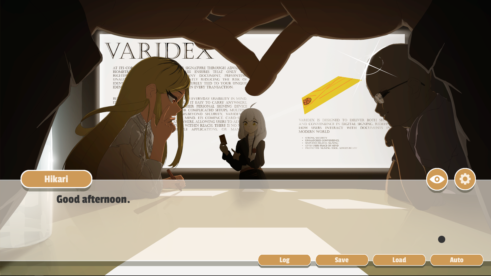
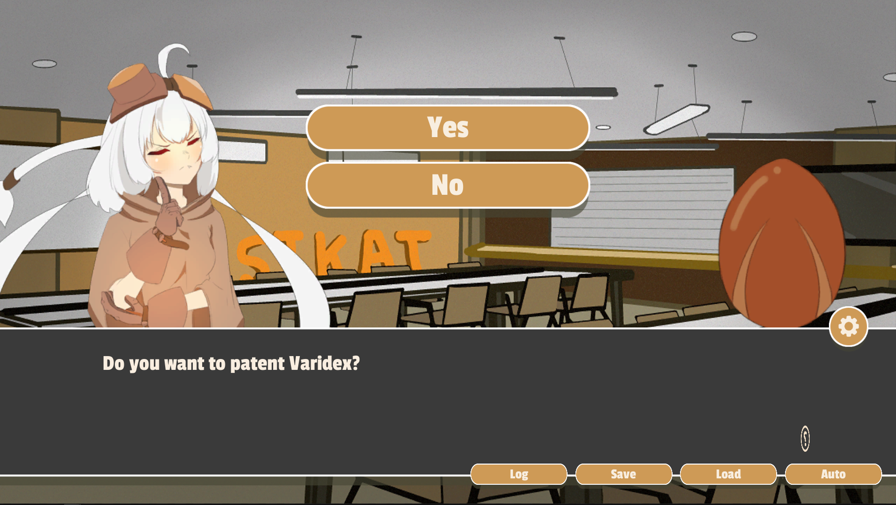
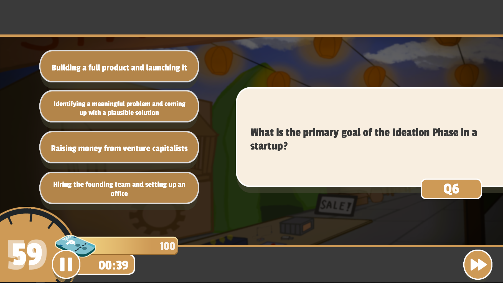
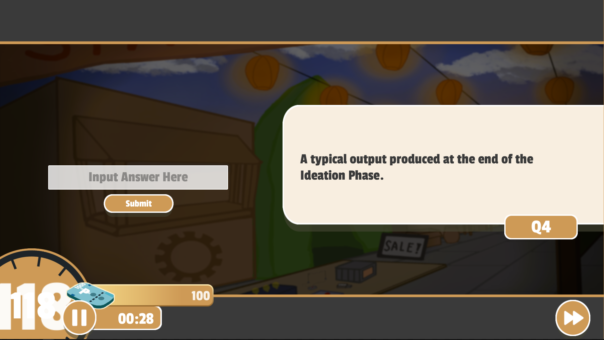
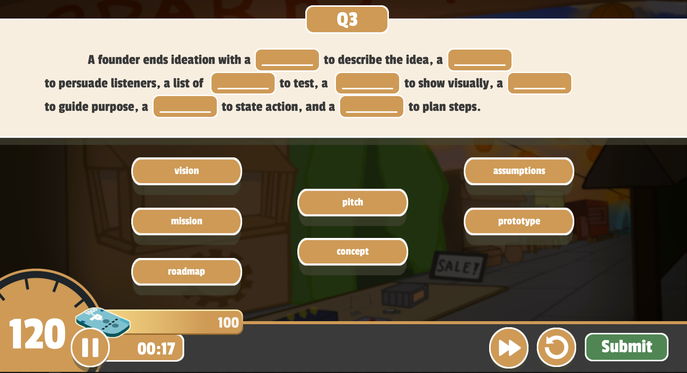
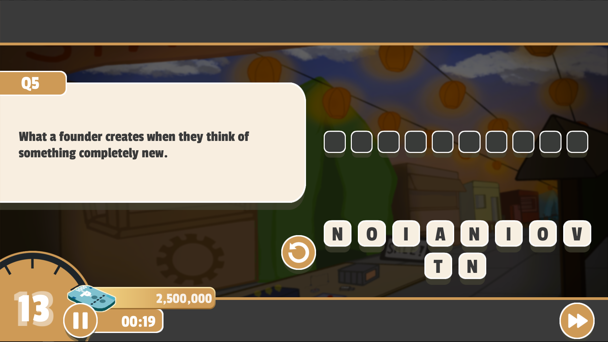
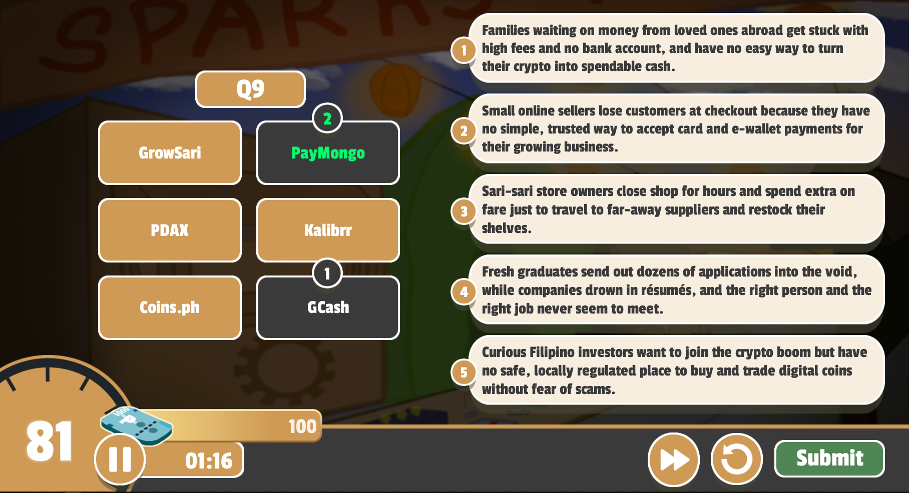
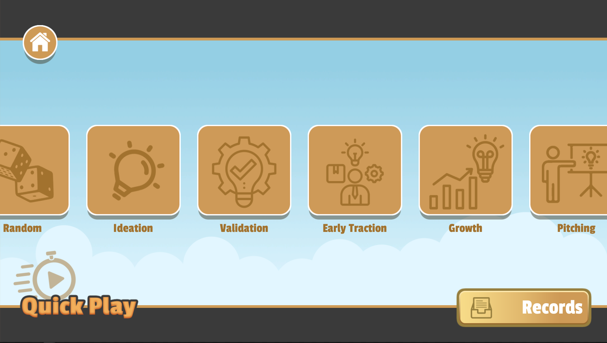
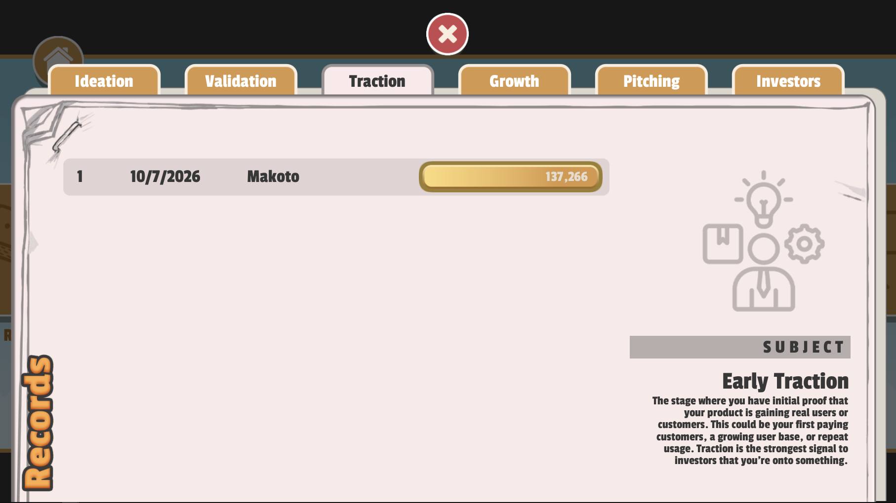

  
   

# SIKAT Adventures 

This repository contains the data and project files of the in-development game SIKAT Adventures (Project Lumina), built in Unreal Engine 4

“SIKAT Adventure” is an educational simulation game designed to help players learn and understand the process of building, managing, and growing a startup business through interactive way.

## Supported Platforms

| Platform | Supported Versions                                                                                |
|---------|---------------------------------------------------------------------------------------------------|
| Windows | 10 and 11 above  |
| Android    | API 19 above |
| Mac    | To be considered |
| Linux    | To be considered |

## Game Features
   1. Story Play
   -    Play through an interactive story on a journey of growing and learning a startup business with decision-based events.
   

  
   
  Story Play Chapter Selection Screen

 
   

<table>
  <tr>
    <td align="center">
       
      Story Dialogue Gameplay
    </td>
    <td align="center">
       
      Story Decisions Gameplay
    </td>
  </tr>
</table>
 

   2. Main Gameplay
   -   The game presents the main gameplay through series of different questions type, these questions include trivia and information about start-ups and entrepreneurships. Your main goal is to gain an amount of money as much as you can by answering these questions quickly.
<table>
  <tr>
    <td align="center">
       
      <em>Multiple Question</em>
    </td>
    <td align="center">
       
      <em>Enumeration</em>
    </td>
  </tr>
</table>

<table>
  <tr>
    <td align="center">
       
      <em>Fill in the Blank</em>
    </td>
    <td align="center">
       
      <em>Jumbled Letters</em>
    </td>
  </tr>
</table>

<table>
  <tr>
    <td align="center">
       
      <em>Problem Matching</em>
    </td>
  </tr>
</table>
 

3. Quick Play
-   An Icebreaker type gameplay where you can select through different Startup Phases categories to play quickly the series of questions on selected category. Attempts can be recorded which can be used as a practice and studying material.
<table>
  <tr>
    <td align="center">
       
      <em>Quick Play Selection</em>
    </td>
    <td align="center">
       
      <em>Records</em>
    </td>
  </tr>
</table>
 

# Credits
- [BPSU SIKAT Technology Business Incubator](https://www.facebook.com/BPSUSIKATTBI) : The game project is created for.
- [Unreal Engine](https://www.unrealengine.com/) : Game Engine used.
